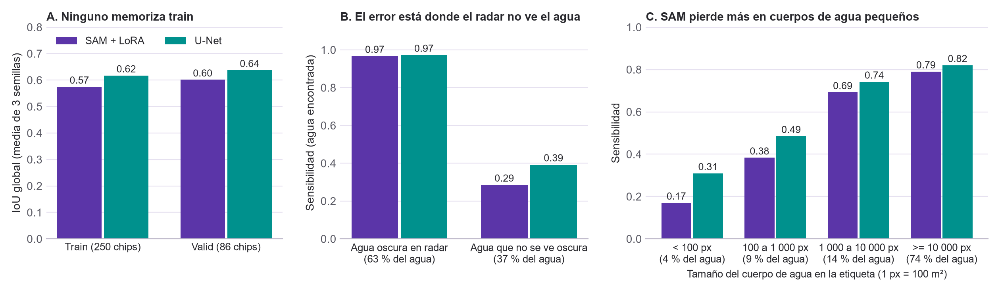

# SAM contra U-Net: por qué pasa y qué probar después

Nota del 12 de noviembre de 2026, preparada con asistencia de Claude Code. Es **exploratoria**: no se entrenó nada, y test y Bolivia no se tocaron. Los diagnósticos usan solo train y valid, con los modelos ya entrenados.

## Conclusión en corto

* **Más parámetros no ayudan aquí porque el límite lo pone el radar, no el modelo.** Los dos modelos encuentran el 97 % del agua que se ve oscura en el radar y fallan en la que no se ve oscura, que es el 37 % del agua etiquetada.
* **SAM no entrena más parámetros que la U-Net, sino menos:** 4.35 millones contra 7.76 millones. Los otros 89 millones de SAM están congelados y se aprendieron con fotos, no con radar.
* **Lo que encontramos ya está publicado para otros modelos fundacionales:** en Sen1Floods11, una U-Net entrenada desde cero queda primera dentro de las regiones de entrenamiento.
* **Siguiente paso recomendado:** una validación cruzada que deja una región fuera cada vez. Es la única pregunta donde el preentrenamiento de SAM podría dar una ventaja, y hoy solo la respaldan 15 chips de Bolivia.
* **Actualización del 13-nov: ya se ejecutó (sección 6).** En regiones no vistas, SAM da 0.554 y la U-Net 0.571, una diferencia de −0.017 con IC por región [−0.067, +0.029]. **No hay evidencia de que uno generalice mejor que el otro.** SAM pierde menos al cambiar de región (0.025 contra 0.055 en valid), pero tampoco es concluyente.

## 1. Lo que dicen nuestros datos

Detalle en `results/hacia_060/exploracion/diagnostico_sam_vs_unet.json`; se regenera con `tools/diagnostico_sam_vs_unet.py`. Todo es sobre valid (86 chips), salvo la primera fila.

| Qué medimos | SAM + LoRA | U-Net | Lectura |
|---|---|---|---|
| IoU global en train y en valid (media de 3 semillas, sin TTA) | 0.575 y 0.601 | 0.617 y 0.637 | Ninguno memoriza train. A SAM le falta ajuste, no le sobra |
| Parámetros entrenados | 4.35 M | 7.76 M | SAM entrena menos, y durante 15 épocas contra 100 |
| Sensibilidad en agua oscura en el radar (63 % del agua) | 0.97 | 0.97 | Los dos la encuentran casi toda |
| Sensibilidad en agua que no se ve oscura (37 % del agua) | 0.29 | 0.39 | Aquí está casi todo el error, y casi toda la ventaja de la U-Net |
| Agua omitida que cae en agua no oscura | 93 % | 93 % | El agua que falta es la que el radar no muestra |
| Sensibilidad en cuerpos de agua de menos de 100 px | 0.17 | 0.31 | SAM pierde más detalle fino |
| Sensibilidad en cuerpos de 10 000 px o más (74 % del agua) | 0.79 | 0.82 | En agua grande casi empatan |

"Agua oscura" significa VH por debajo de −23.3 dB tras el filtro de mediana, el mismo umbral fijo elegido en train. Es un criterio simple: parte del agua "no oscura" sí se puede detectar por el contexto o por VV, y por eso los modelos recuperan entre 29 % y 39 % de ella.

**Los dos modelos se equivocan en lo mismo.**

* La correlación del IoU por chip entre ambos es 0.97.
* El 88 % del agua que omite la U-Net también la omite SAM.
* Promediar SAM con la U-Net no mejora: 0.644 contra 0.642 de la U-Net sola (+0.001, IC 95 % [−0.012, +0.016]).
* Un mapa que detectara toda el agua oscura y ninguna otra, sin falsas alarmas, tendría IoU 0.633. Los dos modelos están en ese nivel (0.615 y 0.642).

**De dónde sale la ventaja de la U-Net.** Su sensibilidad total supera a la de SAM en 4.3 puntos, y 3.9 de ellos vienen del agua que no se ve oscura. SAM, en cambio, da menos falsas alarmas en tierra clara (0.9 % contra 1.3 %).

**La resolución de salida de SAM no es el límite.** Si la etiqueta se redujera a 256 × 256 y se volviera a ampliar, el IoU máximo sería 0.958.

No sabemos por qué cada zona de agua no se ve oscura. Causas conocidas en radar son el viento sobre el agua, la vegetación inundada y los ríos más angostos que la resolución; no medimos cuál pesa más. Tampoco pudimos abrir el paper del dataset para confirmar cómo se hicieron las etiquetas.

## 2. Lo que dice la literatura

Los PDF están en `referencias/`, carpeta que git ignora. Las cifras de esta tabla se comprobaron en el texto de cada PDF, salvo la última fila.

| Trabajo | Qué encontró | Qué significa para nosotros |
|---|---|---|
| Garg et al. 2023, Tabla 2 | Con el mismo modelo y las mismas etiquetas manuales, IoU de 67.63 % con radar, 79.02 % con óptico y 79.25 % con ambos | El techo lo pone el sensor. Sin óptico, nadie pasa de ~0.68 con etiquetas manuales |
| PANGAEA (Marsocci et al. 2024) | En Sen1Floods11, la U-Net supervisada (91.42 mIoU) supera a todos los modelos fundacionales geoespaciales (el mejor, CROMA, 90.89), también con 10 % de las etiquetas | Que la U-Net gane no es un defecto nuestro. Usan también óptico y otra métrica, así que las cifras no se comparan con las nuestras |
| Marti-Escofet et al. 2025, Tablas 4 y 5 | En Sen1Floods11 con óptico: U-Net desde cero primera en test (90.75). En Bolivia, solo un modelo fundacional la supera (Clay con LoRA, 88.88 contra 87.81); otro con LoRA cae a 61.25 | El mismo patrón que vimos: U-Net gana en test y un modelo adaptado gana por poco en Bolivia. No es una regla: depende del modelo |
| Xu et al. 2024 (ICLR 2025) | En imágenes satelitales, un modelo supervisado bien ajustado de 32 M queda a menos de 1 % de modelos fundacionales con 2 a 10 veces más parámetros | Más parámetros preentrenados no garantizan ganar |
| Conv-LoRA (Zhong et al., ICLR 2024) | El codificador de SAM es un ViT sin sesgos locales, y su preentrenamiento aprende poca semántica (54.2 % contra 67.7 % de MAE en ImageNet). Agregar convoluciones a LoRA sube poco: 62.2 a 62.6 de IoU en carreteras | Explica por qué SAM pierde detalle fino. Arreglarlo daría una mejora pequeña |
| HQ-SAM (Ke et al. 2023) y SAM 2 (Ravi et al. 2024) | Ambos agregan al decodificador características de alta resolución del codificador para recuperar estructuras finas | Es el cambio de arquitectura que atacaría nuestra debilidad en cuerpos pequeños |
| Dasgupta y Zouaidi, EGU 2026 (solo resumen) | Con radar: dentro de la distribución todos empatan (~0.82 mIoU). Fuera de ella, Prithvi 0.768 y SegFormer 0.772 superan a la U-Net 0.712 | Si un modelo preentrenado ayuda, es al generalizar a regiones nuevas. Es un resumen de congreso, no un paper revisado |

## 3. Respuesta a "SAM tiene muchos más parámetros, debería ganar"

1. **Los parámetros extra no se entrenan.** De los 93.7 millones de SAM ajustamos 4.35. El resto guarda lo aprendido con fotos, y la literatura muestra que ese conocimiento se transfiere poco al radar.
2. **El problema no pide más capacidad.** Ningún modelo memoriza train, y los dos llegan al mismo techo: el agua que el radar deja ver.
3. **La arquitectura de SAM pierde detalle.** Su codificador resume la imagen en una grilla de 64 × 64 y no pasa detalle fino al decodificador. La U-Net sí lo hace, y por eso encuentra casi el doble de los cuerpos de agua pequeños.

## 4. Opciones y recomendación

| Opción | Costo | Qué esperar | Veredicto |
|---|---|---|---|
| **A. Validación cruzada dejando una región fuera**, con los dos modelos tal como están | ~5 h de GPU con 1 semilla; no toca test ni Bolivia | Convierte "15 chips de Bolivia" en 10 regiones y 336 chips. Cualquier resultado sirve para presentar | **Recomendada** |
| B. Entrenar SAM más épocas (45 en vez de 15) | ~47 min por semilla | Prueba si a SAM le faltó entrenamiento. Mejora probable pequeña | Barata; opcional después de A |
| C. Dar detalle fino al decodificador de SAM (al estilo de HQ-SAM o Conv-LoRA) | Días de código y pruebas | Como mucho, igualar a la U-Net en cuerpos pequeños: +1.4 puntos de sensibilidad | No ahora |
| D. Información óptica al entrenar, o modelos preentrenados con radar | Datos y código nuevos | Es lo único que sube el techo, pero cambia el proyecto | Trabajo futuro |

Test y Bolivia ya se usaron. Ningún modelo nuevo tendría una evaluación limpia ahí, así que las opciones B y C solo darían resultados exploratorios. La opción A no los necesita.

## 5. Borrador de pre-registro de la opción A

No se ha ejecutado. El equipo debe revisarlo antes de correrlo.

* **Pregunta:** ¿SAM con LoRA generaliza mejor que la U-Net a regiones que no vio al entrenar?
* **Datos:** train y valid juntos, 336 chips de 10 regiones. Test y Bolivia no se usan.
* **Diseño:** 10 pliegues. En cada uno se entrena con 9 regiones y se predice la que quedó fuera.
* **Modelos:** `lora_db3_otsu` y `unet_db3` con la configuración ya fijada, última época, umbral 0.5 y semilla 0. Sin búsqueda de hiperparámetros.
* **Métrica principal:** IoU global sobre los 336 chips, cada uno predicho por el modelo que no vio su región. Secundaria: lo mismo con TTA.
* **Prueba:** diferencia SAM − U-Net con bootstrap pareado por región y Wilcoxon sobre las 10 regiones.
* **Regla:** se dirá que un modelo generaliza mejor solo si el IC 95 % por región excluye el cero. Si lo incluye, se dirá que no hay evidencia de diferencia.
* **Límite:** con 10 regiones el intervalo será ancho, y se usa una sola semilla. Si el resultado queda cerca del cero, harían falta más semillas.
* **Expectativa previa:** incierta. La literatura sugiere una ventaja pequeña o nula para el modelo preentrenado.

La versión final del pre-registro es la sección 2e de la bitácora.

## 6. Resultado de la opción A (13-nov-2026)

Se ejecutó entre el 12 y el 13 de noviembre (detalle, tabla por región y expectativas en la sección 3k de la bitácora; figura en `results/figuras/validacion_por_region.png`).

* **Regla:** SAM − U-Net = −0.017, IC 95 % por región [−0.067, +0.029]. El IC incluye el cero: **no hay evidencia de diferencia.** La U-Net gana en 7 regiones y SAM en 3 (Wilcoxon p = 0.43).
* **Caída al cambiar de región**, en los 86 chips de valid: SAM 0.612 → 0.587 y U-Net 0.639 → 0.584. Fuera de su región quedan empatados, y SAM cae 0.030 menos (IC [−0.001, +0.075]): un indicio en la dirección de Bolivia, no una prueba.
* **La región manda:** el IoU va de 0.19 a 0.86 según la región, con los dos modelos. En Sri-Lanka, el umbral fijo en VH supera a ambos.
* **Respuesta a la pregunta inicial:** más parámetros preentrenados no dan una ventaja medible. La U-Net gana dentro de las regiones de entrenamiento y, fuera de ellas, los dos son indistinguibles con 10 regiones y una semilla.

## Fuentes

* Garg et al. 2023, [arXiv:2302.08180](https://arxiv.org/abs/2302.08180)
* Marsocci et al. 2024, PANGAEA, [arXiv:2412.04204](https://arxiv.org/abs/2412.04204)
* Marti-Escofet et al. 2025, [arXiv:2504.17397](https://arxiv.org/abs/2504.17397)
* Xu et al. 2024, [arXiv:2411.02796](https://arxiv.org/abs/2411.02796)
* Zhong et al. 2024, Conv-LoRA, [arXiv:2401.17868](https://arxiv.org/abs/2401.17868)
* Ke et al. 2023, HQ-SAM, [arXiv:2306.01567](https://arxiv.org/abs/2306.01567)
* Ravi et al. 2024, SAM 2, [arXiv:2408.00714](https://arxiv.org/abs/2408.00714)
* Dasgupta y Zouaidi 2026, [EGU26-6586](https://meetingorganizer.copernicus.org/EGU26/EGU26-6586.html)
